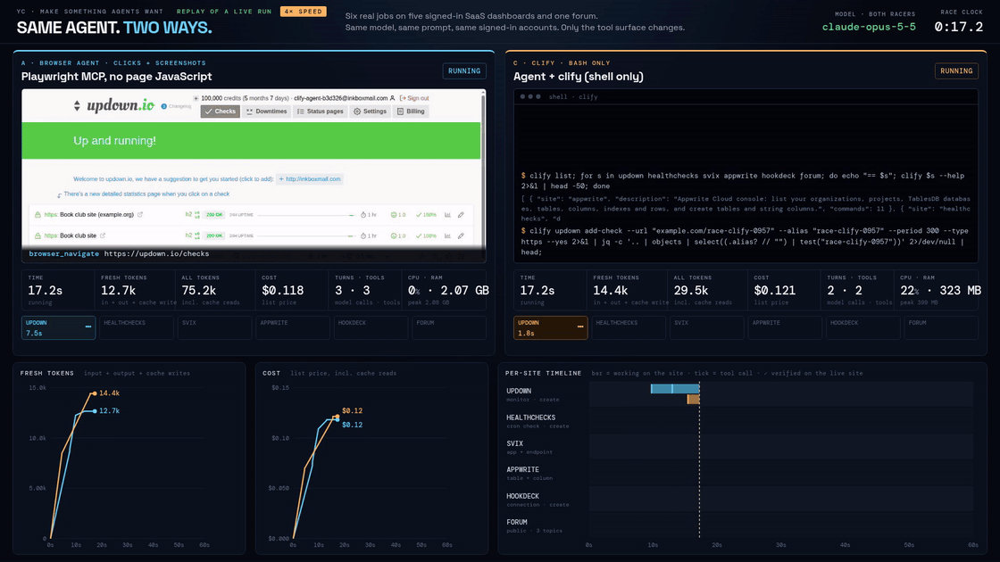
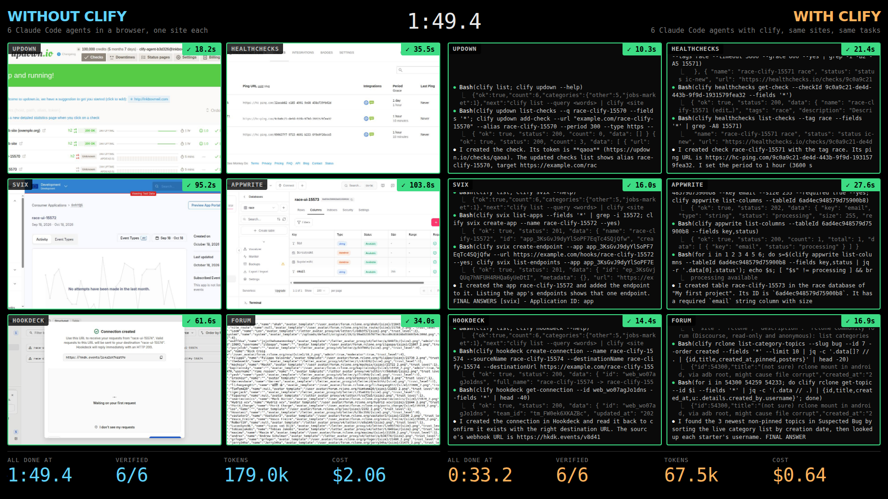
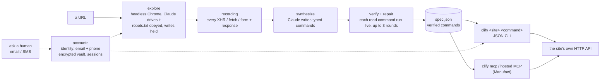

# clify: the web, rebuilt for agents

**clify turns most websites into a JSON CLI and an MCP server**: so far 133 of 160 public sites tried (open data and government, developer registries, science, maps and weather, culture, news, sports, jobs). An agent explores the site once in a headless browser, records the requests behind what it clicks, writes a typed command for each, and tests every command live before keeping it. After that, agents call the site's own endpoints instead of clicking through pages: same answers, a fraction of the time, tokens and RAM. When a site needs an account, clify signs in with its own identity (email and phone) or with yours. When it hits a CAPTCHA, it stops and asks a human.



<sub>Replay of one live run (`2026-10-18T09-57-57-642Z`), sped up: the GIF starts at 0:17 on the race clock, once the browser has loaded its first page, and plays the 4× video at 4× again (16×). The same model (Claude Opus 5.5) does the same six jobs on five signed-in SaaS dashboards and a forum, once through a browser and once through clify with specs generated by `clify add` (5 of 6 CLIs generated; svix's robots.txt forbids exploring, so its spec is hand-written). This run: 4.0× faster, 7.3× cheaper. Over all 6 runs: 3.3× faster by mean time (288 s vs 87 s), paired per-run mean 3.5×; 7.3× cheaper by mean cost, paired 7.4×. Details below and in [race/](race/README.md).</sub>

**In numbers:** 160 sites tried → 133 with 3+ live-verified commands (1,634 verified commands in all) → 132 ship in the CLI, 135 on the hosted MCP (the 132 + 3 test-suite sites: Wikipedia, HN search, an httpbin echo form).

Built for YC's *Make Something Agents Want* hackathon (Oct 17–18, 2026).

## Use it with curl, nothing to install

The public agent API is at https://clify-dev.netlify.app. It needs no install, key, or account:

```bash
curl https://clify-dev.netlify.app/search?q=rust+crates
curl "https://clify-dev.netlify.app/crates/get-crate?name=serde"
```

Use `/sites.json` for the catalogue, `/llms.txt` for the full agent guide, and `/<site>.json` for commands and verified example URLs.

## Live demo: 6 browser agents vs 6 clify agents



Twelve Claude Code agents (Claude Opus 5.5) start at the same moment: on each of the six sites above, one works in a browser and one with clify, same prompt, same accounts. Every account was created by the agent itself with its own email. Each tile turns green when an independent check finds the object on the live site. Recorded live run of Oct 18, 08:58 PT: clify all 6 verified at 0:27.6 for $0.64; browser agents all 6 verified at 1:43.8 for $2.06. Run it yourself: `race/bin/grid` (on the machine with the sessions) or `race/bin/mac-demo` (from a laptop, over ssh); details in [race/](race/README.md#grid-6-browser-agents-vs-6-clify-agents).

## Try it in 10 seconds (hosted MCP, nothing to install)

```bash
claude mcp add --transport http clify https://bold-cloud-h4u6s.run.mcp-use.com/mcp
```

Then ask your agent something like *"latest serde version on crates.io and the NWS forecast for San Francisco"*. The server holds 135 sites and 1,619 live-verified commands behind 3 core tools (`clify_sites`, `clify_help`, `clify_run`) plus 4 direct shortcuts for popular commands; the whole tool list costs about 2.5k tokens instead of 569k (one tool per command), and the 3 core tools alone about 1.4k. Codex: `codex mcp add clify --url https://bold-cloud-h4u6s.run.mcp-use.com/mcp`. Read-only and public; write commands return a preview and need `confirm: true`. More in [mcp/](mcp/README.md).

**Or email the agent:** send `clify@fine-vale.primitive.email` a question like *"latest tokio version and its downloads"*. The [always-on clify agent](agent/README.md) runs it with clify on its own InstaBox and answers in your thread, usually within a minute (read-only public sites, 5 jobs per sender per day).

**Is it alive?** <https://clify-agent-b3d326.inkboxwire.com/status>: the agent's read-only status page (uptime, jobs today, last reply, model), served from its InstaBox at its Inkbox internet address.

## Quickstart (local CLI)

Node 22+. clify is not on npm (`npm i clify` is an unrelated package): clone the repo. `clify add` and logins need Chromium; using a CLI needs nothing else.

```bash
git clone https://github.com/ToukoUrsin/clify && cd clify/clify
npm install
npx playwright install chromium               # for `clify add`, `repair`, `login` (or set CLIFY_CHROME)
export PATH="$PWD/bin:$HOME/.clify/bin:$PATH"

clify list --query rust                       # find a site: 132 verified site CLIs ship built in
clify crates search-crates --q "http client" --sort downloads --limit 3
clify weather get-point --lat 37.77 --lon -122.42

export ANTHROPIC_API_KEY=...                  # model access, only for `clify add` / `repair`
clify add https://metacpan.org/               # explore → generate → verify live → install (2–6 min typical, up to ~15 on big sites)
```

Every command prints one JSON object (`{"ok":true,"count":N,"nextPage":...,"data":...}`); errors carry `next`, the exact command to run next. `clify mcp` serves everything installed as a local MCP server. Agents should start at [AGENTS.md](AGENTS.md), [clify/AGENTS.md](clify/AGENTS.md), [llms.txt](llms.txt) or `clify guide`.

## Headline numbers

All runs are real, on live sites, with `claude-opus-5-5`. Ratios are clify vs a browser agent doing the same task with the same model and prompt.

| Test | Result | Evidence |
|---|---|---|
| **Race, specs generated by `clify add`** (6 jobs on 5 signed-in dashboards + 1 forum; 6 runs, every racer 6/6 verified; 5 of 6 specs generated: svix's robots.txt forbids exploring, so its spec is hand-written and labelled) | **3.3× faster by mean time (288 s vs 87 s); paired per-run mean 3.5×.** 7.3× cheaper by mean cost ($2.06 vs $0.28; paired 7.4×), 14.4× fewer tokens incl. cache (paired 14.8×), 9.5× less RAM (paired 9.4×) | [race/README.md](race/README.md), [generated-r5-runs.txt](race/results/generated-r5-runs.txt), [specs + generation logs](race/specs-generated/), video [accounts-4x.mp4](race/artifacts/accounts-4x.mp4) |
| Race, hand-written specs (same jobs, 7 runs) | 4.5× faster by mean time (314 s vs 69 s); paired per-run mean 4.4×. 6.2× cheaper by mean cost ($1.87 vs $0.30; paired 6.2×), 13.0× fewer tokens incl. cache (paired 12.9×), 10.0× less RAM (paired 10.1×) | [accounts-runs.txt](race/results/accounts-runs.txt), video [accounts-4x-handwritten.mp4](race/artifacts/accounts-4x-handwritten.mp4) |
| Browser with page JavaScript (mode B, the strong baseline), round 5 | B 253 s / $1.74 vs clify 108 s / $0.30 in the same run: clify 2.3× faster, 5.9× cheaper, 10.6× fewer tokens incl. cache. Page JavaScript barely helps on these dashboards (B 253 s vs clicks-only A's 288 s mean); B's means in earlier rounds: 341 s (round 3, n=3), 435 s (round 4, n=2) | [race/README.md](race/README.md), [generated-r5-runs.txt](race/results/generated-r5-runs.txt) |
| **Benchmark: 20 easy public read-only tasks on 11 sites (10 of the 20 tasks on 4 scraping-practice sites), hand-written specs, 40 runs per mode** (the CLIs for these 11 sites were written by hand before the benchmark, not generated; ground truth was recomputed with clify right before each run, and an independent recheck without clify agrees on 20 of 20 tasks: [truth-check.txt](bench/results/truth-check.txt)) | all modes 40/40 correct. clify 9.0 s / 16.5k tokens / $1.28 total vs clicks-only browser 16.1 s / 79.4k / $4.12: **1.8× faster, 4.8× fewer tokens, 3.2× cheaper**. vs browser + page JS: 1.4× / 3.1× / 1.8× | [bench/README.md](bench/README.md), [summary](bench/results/summary-main+hard+ui+ui2.json), every run's prompt and result in [bench/runs/](bench/runs/) |

"By mean" divides the browser's mean (clicks-only runs) by clify's mean (all runs); "paired" is the mean of the per-run ratios in the clicks-only runs, where both racers ran at the same moment. With generated specs the clify agent now makes as many model calls as with hand-written ones (16.8 vs 17 per run) and costs about the same ($0.28 vs $0.30): `clify add` fills the signed-in account's project/org/team ids in by itself and prints compact help ([race/README.md](race/README.md), round 5). Both sets are published. Every number in this README is derived from its source files and checked by [scripts/counts.mjs](scripts/counts.mjs).

## Versus an agent with curl

Same model, same prompts, the agent given curl, jq, python3, WebFetch and WebSearch instead of clify (no browser):

- **Public read-only benchmark: curl wins.** curl 40/40, 7.5 s / 10.2k tokens / $1.12 vs clify 40/40, 9.0 s / 16.5k / $1.28 (median time, median tokens, total cost). These sites have documented JSON APIs or are scraping sandboxes the model knows by heart, so curl usually answers in one call; clify reads its help first. [bench/README.md](bench/README.md#versus-an-agent-with-curl)
- **Signed-in dashboards (race mode D, curl handed the same saved cookies and tokens as files): both 6/6, clify ahead.** D 97 s / $0.52 vs clify 66 s / $0.29 in the same 2 runs (D 6/6 and clify 6/6 every run; paired: D 1.5× slower, 1.8× the cost). curl spends its extra calls re-discovering forms, CSRF fields and API paths in every run; on the public forum it beat clify. [race/README.md](race/README.md) (mode D)

So clify's value is not on sites whose API the model already knows. It is in the signed-in, undocumented parts: requests discovered once and verified by `clify add` instead of re-discovered every run, sessions kept in a vault (the login, signup and 2FA that produced the sessions D used were clify's), and account ids filled in. Most of the gap to a browser agent is the browser: curl with sessions is also 3× faster and 4× cheaper than clicking.

## What's proven

- **Most URLs → verified CLI.** `clify add` on 44 public sites it had never seen: **41 (93%)** ended with 3 or more live-verified commands, **514** verified in total, 2–6 minutes each, no human edits. The 3 misses are behind bot walls, which clify reports and does not get around. [clify/proofs/sites.md](clify/proofs/sites.md). A second sweep of 116 more sites in Blaxel sandboxes brings it to **133 of 160 sites** with 3+ verified commands and **1,634 verified commands** (1,628 of them on those 133 sites, listed in [wall.json](clify/proofs/wall.json); 6 more on 3 sites that stayed under 3); every miss is listed with its reason. 132 of the 133 ship built into clify (RubyGems' generated spec stays in [proofs/sites/](clify/proofs/sites/)). [clify/proofs/sites-blaxel.md](clify/proofs/sites-blaxel.md)
- **Agents use it unaided.** Fresh `claude -p` agents with Bash limited to `clify` solved 6/6 real tasks ([handoff.md](clify/proofs/handoff.md)). **Cold start:** a fresh agent in an empty directory cloned this public tree, installed clify, ran `clify add https://flathub.org/` itself (8 of 8 commands verified) and answered correctly in 177 s ([cold-start.md](clify/proofs/cold-start.md)).
- **Its own accounts.** With one identity (an Inkbox mailbox and phone number), the agent signed itself up on **19 sites**, 18 of them verified by email link or code, and all 19 work over plain HTTP with the browser closed. It read an **SMS code** to verify its phone on Appwrite and passed an **SMS 2FA** login. [clify/test/accounts/results.md](clify/test/accounts/results.md), [ACCOUNTS.md](clify/ACCOUNTS.md)
- **Ask a human, over email.** Blocked by a CAPTCHA or about to write, clify emails its human from its own Primitive email address with a screenshot and fixed options, accepts only a DMARC-verified reply from the person it asked, and can forward the thread to a peer agent. Three live transcripts: [clify/test/ask/](clify/test/ask/).
- **An agent that lives on its own computer.** An always-on email agent on an [InstaBox](https://instabox.sh) sandbox takes jobs by email, asks clarifying questions in the thread, delegates to a peer agent, uses clify with its own accounts and replies with attachments. It survived a full `instabox stop` / `start` (services back at boot, answering the next job) and the sandbox's own idle pause. Anyone can email it: strangers get a read-only public tier with daily caps, enforced in code ([public-tier.md](agent/proofs/public-tier.md)). Check it's alive without emailing it: [status page](https://clify-agent-b3d326.inkboxwire.com/status) ([status.md](agent/proofs/status.md)). [agent/](agent/README.md), [proofs](agent/proofs/), 88 s [video](agent/proofs/video/clify-agent.mp4).
- **MCP on Manufact.** The hosted [mcp-use](https://mcp-use.com) server answered the same two-site task correctly in 4 clients: Claude Code, Codex CLI, an mcp-use agent and the mcp-use Inspector. [mcp/README.md](mcp/README.md), [transcripts](mcp/demo/).
- **One sandbox per website, in parallel.** The verified-site sweep ran in [Blaxel](https://blaxel.ai) sandboxes, one Chrome per site, with `clify check` run inside the sandbox. [clify/proofs/wall.json](clify/proofs/wall.json)

## How it works



| Dir | What |
|---|---|
| [clify/](clify/README.md) | The product: `clify add/repair/check`, the runtime, accounts and vault, ask-a-human, stdio MCP, 132 built-in specs, tests and proofs |
| [mcp/](mcp/README.md) | Hosted MCP server (mcp-use, deployed on Manufact) over clify's runtime core |
| [race/](race/README.md) | Live race dashboard: browser agent vs clify agent, live time / tokens / cost / CPU / RAM, replay and recording |
| [bench/](bench/README.md) | 20-task benchmark, three modes, every run's prompt and result |
| [agent/](agent/README.md) | Always-on email agent on an InstaBox sandbox, using clify |
| [film/](film/README.md) | The 2-minute film (Remotion); every number traced to a file in this repo |

## Responsible by design

Giving agents accounts and fast access to the web is only useful if sites can trust what arrives. clify is built to be the well-behaved client, and the rules are enforced in code:

- **Never solves CAPTCHAs.** reCAPTCHA, hCaptcha, Turnstile, Arkose, invisible ones included, and "verify you are human" pages stop the flow with `captcha at <url>`. No solver services, no audio or vision tricks, no token injection. The agent asks its human instead.
- **No bot evasion.** Stock headless Chrome and an honest `clify/<version>` user agent. No stealth plugins, UA spoofing, proxies or fingerprint tricks.
- **Reads the terms first.** Before any signup, Claude reads the site's terms and robots.txt; an explicit ban on automated accounts stops it, and so does not finding the terms at all. robots.txt is obeyed while exploring.
- **Honest identity, one identity.** Signups use the name "clify agent" and the agent's own mailbox and phone. One persistent identity, not throwaway accounts; optional fields stay empty, marketing opt-ins unticked, no payment details ever.
- **Writes need confirmation.** Exploration records writes but does not send them (unless explicitly allowed). Write commands return a dry-run preview; nothing is sent without `--yes` / `confirm: true`, or a verified human "approve" by email. No posting on real-identity social networks (LinkedIn, X, Facebook, Instagram, ...).
- **Secrets stay local.** Passwords, 2FA secrets and sessions live in an AES-256-GCM vault; the model types `{{password}}` placeholders and never sees the values. Sessions are sent only to the site's own domain.
- **Every attempt is published.** All 65 signup attempts are in [results.md](clify/test/accounts/results.md), including the **46 stops**: 33 at a CAPTCHA or bot check, 4 terms bans, 4 sites whose terms could not be found, 5 refusals (VPN flag, fraud flag, geo block, OAuth-only, a form the agent couldn't operate).

The signups were made to show that an agent can hold a real, verifiable identity, not to farm accounts: each site got one account, made in the open under the agent's own name, on sites whose terms allow it, and the race and agent only ever touch objects they created themselves (named `race-*` and deleted after every run).

## Hackathon tracks → evidence

| Track | What we built for it | Evidence |
|---|---|---|
| **Armature** (products coding agents choose and use on their own) | Agent-first docs and errors: AGENTS.md, llms.txt, SKILL.md, `clify guide`; JSON everywhere, `next` on every error. A fresh agent clones, installs and generates a CLI by itself. | [cold-start.md](clify/proofs/cold-start.md), [handoff.md](clify/proofs/handoff.md), [clify/AGENTS.md](clify/AGENTS.md), [SKILL.md](clify/SKILL.md) |
| **Manufact** (MCP) | mcp-use v2 server deployed on Manufact Cloud: 135 sites, 1,619 commands, 3 core tools (+4 shortcuts), 2.5k tokens for the whole tool list; same runtime as the CLI | [mcp/README.md](mcp/README.md), [probe-deployed.txt](mcp/demo/probe-deployed.txt), 4 client [transcripts](mcp/demo/) |
| **Primitive** (email for agents) | clify's ask-a-human loop and the always-on agent both work over a Primitive address: DMARC-checked replies, threads as context, forward = delegation | [clify/test/ask/](clify/test/ask/), [agent/proofs/](agent/proofs/) |
| **Inkbox** (agent identity) | The agent's mailbox and phone number: 19 self-signups verified by email, an SMS code and SMS 2FA, a peer agent on its own Inkbox mailbox, and the agent's internet address: its public status page runs through the identity's Inkbox tunnel | [results.md](clify/test/accounts/results.md), [ACCOUNTS.md](clify/ACCOUNTS.md), [2-delegate.md](agent/proofs/2-delegate.md), [status.md](agent/proofs/status.md) |
| **Blaxel** (something a human would never want) | A CLI for most websites (133 of 160 sites so far): no human wants one, every agent does. The site sweep runs in Blaxel sandboxes | [clify/proofs/wall.json](clify/proofs/wall.json) |
| **InstaBox** (an agent that lives on its own computer) | The clify email agent runs as systemd services on its own InstaBox, with its own vault, survives a full stop/start, and takes jobs from anyone by email (read-only public tier); a public [status page](https://clify-agent-b3d326.inkboxwire.com/status) shows it's alive | [agent/README.md](agent/README.md), [instabox.md](agent/proofs/instabox.md), [status.md](agent/proofs/status.md), [video](agent/proofs/video/clify-agent.mp4) |

## Limits

clify does not work on every site. Bot walls, CAPTCHAs, data that only exists after heavy client-side rendering with no API behind it, and robots.txt-disallowed sections are reported as blockers, not worked around. Generated specs can drift when a site changes; `clify check` re-runs every example and `clify repair` fixes what broke. The race needs the agent's own signed-in accounts on five dashboards; to reproduce it, sign an identity up (`clify signup`) or log in with yours (`clify login --user`).

## License

MIT, see [LICENSE](LICENSE).
