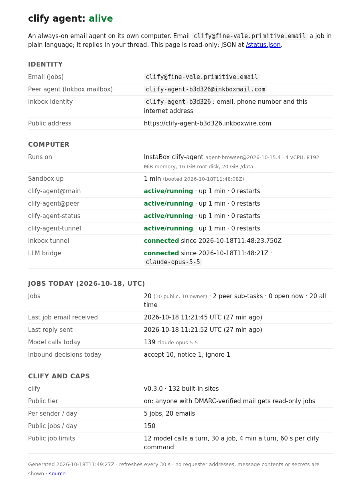

# Proof: a public, read-only status page, at the agent's Inkbox internet address

**Is it alive?** <https://clify-agent-b3d326.inkboxwire.com/status> (HTML in a browser, JSON for `curl`; also `/status.json`, `/healthz`)

Anyone can check the agent without emailing it. The page shows its identity, the InstaBox it runs on, how long the sandbox and each service have been up, the LLM bridge, jobs today (public / owner), the last job received and the last reply sent, the model that answered, the clify version and number of built-in sites, and the caps. It shows no requester addresses, subjects, message contents or secrets: `status/server.ts` reads counts and timestamps from the job files and systemd and copies nothing else out.

How it is served:

- `clify-agent-status` (systemd, on the InstaBox, next to `clify-agent@main`): `status/server.ts` on `127.0.0.1:18320` only. GET/HEAD only (else 405), 60 requests a minute per client IP and 600 overall (then 429 with `Retry-After: 60`), 10 s cache, `ProtectSystem=strict` (it can write nothing).
- `clify-agent-tunnel` (systemd, on the InstaBox): `status/tunnel.ts` connects the Inkbox tunnel of the agent's identity `clify-agent-b3d326` with `@inkbox/sdk` (`connect()`, one outbound HTTP/2 connection; the InstaBox has no inbound ports) and passes GET/HEAD to the status server with the caller's IP. The Inkbox key comes from the peer's vault on the InstaBox disk; it is never printed or logged. So the identity is now email + phone number + internet address, all from Inkbox.
- The tunnel client runs on the InstaBox itself; no proxy through the box was needed.

All `curl` below ran on the AWS box (not the InstaBox), over the public HTTPS URL, on 18 Oct 2026.

## The Inkbox tunnel record (Inkbox API, `GET /api/v1/tunnels`, selected fields)

```json
{
 "tunnel_name": "clify-agent-b3d326",
 "public_host": "clify-agent-b3d326.inkboxwire.com",
 "tls_mode": "edge",
 "status": "active",
 "currently_connected": true,
 "last_connected_at": "2026-10-18T11:48:23.905253Z"
}
```

## It survives a restart

A full `instabox stop` / `instabox start` (11:47:23–11:48:21 UTC; "a stop ends every process"). systemd started all four services at boot (`booted_at 11:48:08Z`, services `since 11:48:20Z`), the tunnel reconnected at 11:48:23 and the public URL answered at 11:48:26, 5 s after `instabox start` returned:

```
$ instabox stop clify-agent && instabox start clify-agent   # 11:47:23 → 11:48:21 UTC
$ curl -s -o /dev/null -w "%{http_code}" https://clify-agent-b3d326.inkboxwire.com/healthz
11:48:26 200
```

## curl over the public URL (after the restart)

```
$ date -u
Sun Oct 18 11:48:46 UTC 2026

$ curl -sS -i https://clify-agent-b3d326.inkboxwire.com/status
HTTP/2 200 
content-length: 2537
access-control-allow-origin: *
cache-control: public, max-age=10
content-security-policy: default-src 'none'; style-src 'unsafe-inline'; frame-ancestors 'none'
content-type: application/json; charset=utf-8
date: Sun, 18 Oct 2026 11:48:46 GMT
referrer-policy: no-referrer
x-content-type-options: nosniff
date: Sun, 18 Oct 2026 11:48:46 GMT
server: hypercorn-h2

{
  "ok": true,
  "generated_at": "2026-10-18T11:48:46Z",
  "agent": {
    "name": "clify agent",
    "email": "clify@fine-vale.primitive.email",
    "peer_email": "clify-agent-b3d326@inkboxmail.com",
    "inkbox_identity": "clify-agent-b3d326",
    "public_url": "https://clify-agent-b3d326.inkboxwire.com",
    "runs_on": "InstaBox clify-agent",
    "how_to_use": "email it a job in plain language; it replies in your thread"
  },
  "computer": {
    "instabox": "clify-agent",
    "template": "agent-browser@2026-10-15.4",
    "size": "4 vCPU, 8192 MiB memory, 16 GiB root disk, 20 GiB /data",
    "booted_at": "2026-10-18T11:48:08Z",
    "uptime_s": 38,
    "load_1m": 0.16
  },
  "services": {
    "clify-agent@main": {
      "state": "active/running",
      "since": "2026-10-18T11:48:20Z",
      "uptime_s": 26,
      "restarts": 0
    },
    "clify-agent@peer": {
      "state": "active/running",
      "since": "2026-10-18T11:48:20Z",
      "uptime_s": 26,
      "restarts": 0
    },
    "clify-agent-status": {
      "state": "active/running",
      "since": "2026-10-18T11:48:20Z",
      "uptime_s": 26,
      "restarts": 0
    },
    "clify-agent-tunnel": {
      "state": "active/running",
      "since": "2026-10-18T11:48:20Z",
      "uptime_s": 26,
      "restarts": 0
    }
  },
  "tunnel": {
    "status": "connected",
    "since": "2026-10-18T11:48:23.750Z"
  },
  "llm_bridge": {
    "listening": true,
    "connected_since": "2026-10-18T11:48:22Z",
    "model": "claude-opus-5-5",
    "route": "127.0.0.1:18318 → instabox ssh stdio → box → Claude Opus 5.5"
  },
  "jobs": {
    "day_utc": "2026-10-18",
    "today": {
      "total": 20,
      "owner": 10,
      "public": 10
    },
    "peer_subtasks_today": 2,
    "open_now": 0,
    "all_time": 20,
    "last_job_received_at": "2026-10-18T11:21:45.935Z",
    "last_reply_sent_at": "2026-10-18T11:21:52.210Z",
    "model_calls_today": 139,
    "models_today": [
      "claude-opus-5-5"
    ],
    "last_model": "claude-opus-5-5",
    "inbound_decisions_today": {
      "accept": 10,
      "notice": 1,
      "ignore": 1
    }
  },
  "clify": {
    "version": "0.3.0",
    "built_in_sites": 132
  },
  "caps": {
    "public_tier": true,
    "per_sender_jobs_per_day": 5,
    "per_sender_emails_per_day": 20,
    "public_jobs_per_day": 150,
    "mails_to_one_sender_per_day": 20,
    "public_limits": {
      "model_calls_per_turn": 12,
      "model_calls_per_job": 30,
      "turn_s": 240,
      "clify_command_s": 60
    },
    "day_resets": "00:00 UTC"
  }
}

$ curl -sS -o /dev/null -w "%{http_code} %{content_type}\n" -H "accept: text/html" https://clify-agent-b3d326.inkboxwire.com/status
200 text/html; charset=utf-8

$ curl -sS -i -X POST https://clify-agent-b3d326.inkboxwire.com/status
HTTP/2 405 
content-length: 23
allow: GET, HEAD
content-type: text/plain;charset=UTF-8
server: hypercorn-h2

read-only: GET or HEAD
$ curl -sS -X DELETE -w " %{http_code}\n" https://clify-agent-b3d326.inkboxwire.com/status.json
read-only: GET or HEAD
 405

$ for i in $(seq 1 70); do curl -s -o /dev/null -w "%{http_code}\n" https://clify-agent-b3d326.inkboxwire.com/status.json; done | sort | uniq -c
     56 200
     14 429
```

(The 70-request loop: the limit is 60 a minute per client IP, and the requests just before it in the same minute count too, so 56 got through and the rest got 429.)

At 12:43 UTC the `route` label was renamed from `box` to `relay` (same path: model calls go through a key-holding relay on a separate machine). Live at 12:47 UTC: `"route": "127.0.0.1:18318 → instabox ssh stdio → relay → Claude Opus 5.5"`.

## The HTML view

Headless Chromium on the InstaBox, loading the public URL:


